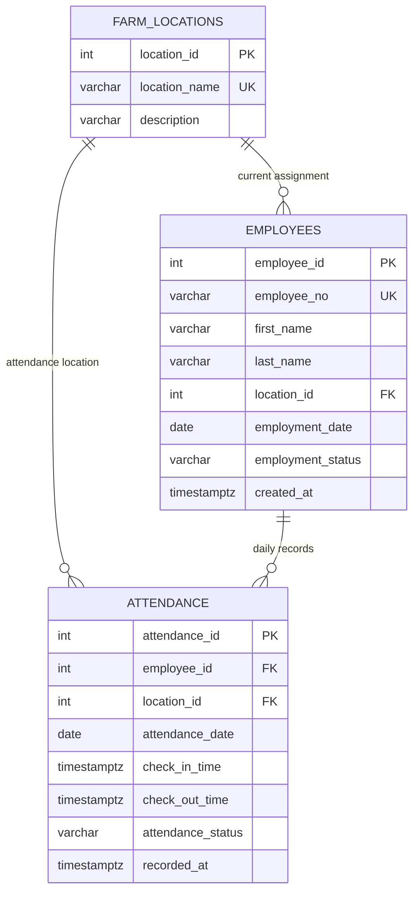

# MIT 8103 – ADVANCED DATABASE SYSTEMS
## PORTFOLIO 1: DATABASE DESIGN AND MODELLING

**Programme:** Master of Information Technology  
**Academic Session:** 2026/2027  
**Semester:** First Semester  
**Case Study:** Agricultural Workforce Attendance Management System  
**Organisation:** GreenFields Agricultural Operations Ltd. (Simulated Organisation)  
**Database Management System:** PostgreSQL 18

---

## 1. Introduction

This portfolio presents the design and implementation of an Agricultural Workforce Attendance Management System for GreenFields Agricultural Operations Ltd., a simulated agricultural organisation operating across multiple farm locations.

The organisation requires a structured database to maintain employee information, record daily workforce attendance and support the retrieval of attendance information for operational monitoring and management reporting.

The proposed database is implemented using PostgreSQL. The design focuses on maintaining data accuracy, enforcing relationships between records, reducing unnecessary data duplication and preserving historical attendance information.

The database consists of three core entities: FARM_LOCATIONS, EMPLOYEES and ATTENDANCE.

## 2. Case Study Description

GreenFields Agricultural Operations Ltd. employs agricultural workers across different farm locations. The organisation needs a reliable way to maintain employee records and capture their daily attendance.

The proposed system supports the following users:

- HR Administrators: Register employees and maintain employment information.
- Farm Supervisors: Monitor employees and their daily attendance.
- Attendance Officers: Record and verify attendance information.
- Management: Retrieve attendance summaries and reports.
- Database Administrators: Maintain the database and its security.

### Major Data Requirements

The database stores:

1. Farm location information.
2. Employee identification and employment details.
3. Employee location assignments.
4. Daily attendance dates.
5. Employee check-in and check-out timestamps.
6. Attendance status.
7. Attendance record creation timestamps.

## 3. Business Requirements

### 3.1 Functional Requirements

| ID | Requirement |
|---|---|
| FR01 | The system shall allow authorised users to register employees. |
| FR02 | Each employee shall have a unique employee number. |
| FR03 | The system shall maintain farm location records. |
| FR04 | Each employee shall have a current farm location assignment. |
| FR05 | The system shall record daily attendance for each employee. |
| FR06 | Each attendance record shall contain an attendance date, check-in time and check-out time where available. |
| FR07 | The system shall maintain the attendance status of each employee. |
| FR08 | Users shall be able to retrieve attendance records by employee, date and farm location. |
| FR09 | The system shall support attendance summaries and management reporting. |
| FR10 | The system shall record when employee and attendance records are created. |

### 3.2 Business Rules

1. Every employee must have a unique employee number.
2. Every employee must be assigned to an existing farm location.
3. One farm location can have many employees.
4. An employee can have multiple attendance records across different workdays.
5. Every attendance record must belong to an existing employee.
6. An employee can have only one attendance record for a particular workday.
7. Every attendance record must have an attendance date and attendance status.
8. Check-in and check-out timestamps may be NULL when attendance has not been completed or when the employee is absent or on leave.
9. Where both timestamps exist, check-out must be later than check-in.
10. Attendance status must be restricted to approved values: Present, Absent, Late and On Leave.

## 4. Database Design and Modelling

### 4.1 Identification of Entities

Three entities were identified from the business requirements.

**A. FARM_LOCATIONS**

Stores information about the different farm locations.

Attributes:
- location_id – Primary key.
- location_name – Name of the farm location.
- description – Additional location information.

**B. EMPLOYEES**

Stores employee identification and employment information.

Attributes:
- employee_id – Primary key.
- employee_no – Unique employee number.
- first_name – Employee's first name.
- last_name – Employee's surname.
- location_id – Foreign key referencing the current farm location.
- employment_date – Employee's employment date.
- employment_status – Active or Inactive.
- created_at – Date and time the employee record was created.

**C. ATTENDANCE**

Stores daily attendance information.

Attributes:
- attendance_id – Primary key.
- employee_id – Foreign key referencing the employee.
- location_id – Foreign key referencing the farm location associated with the attendance.
- attendance_date – Workday associated with the attendance record.
- check_in_time – Employee's check-in timestamp.
- check_out_time – Employee's check-out timestamp.
- attendance_status – Attendance status.
- recorded_at – Date and time the attendance record was created.

### 4.2 Entity Relationship Diagram

The database contains three principal relationships:

1. FARM_LOCATIONS to EMPLOYEES: One-to-many.
2. EMPLOYEES to ATTENDANCE: One-to-many.
3. FARM_LOCATIONS to ATTENDANCE: One-to-many.

The location reference in ATTENDANCE preserves the farm location associated with an individual attendance record, even when an employee's current location assignment changes.

**ERD representation:**

## 5. Relational Schema

The relational schema consists of the following tables.

**FARM_LOCATIONS**

FARM_LOCATIONS(
- location_id [PK],
- location_name [UNIQUE],
- description
)

**EMPLOYEES**

EMPLOYEES(
- employee_id [PK],
- employee_no [UNIQUE],
- first_name,
- last_name,
- location_id [FK],
- employment_date,
- employment_status,
- created_at
)

**ATTENDANCE**

ATTENDANCE(
- attendance_id [PK],
- employee_id [FK],
- location_id [FK],
- attendance_date,
- check_in_time,
- check_out_time,
- attendance_status,
- recorded_at,
- UNIQUE(employee_id, attendance_date)
)

## 6. Primary Keys, Foreign Keys and Constraints

### 6.1 Primary Keys

Primary keys uniquely identify records in each table.

| Table | Primary Key |
|---|---|
| FARM_LOCATIONS | location_id |
| EMPLOYEES | employee_id |
| ATTENDANCE | attendance_id |

The identifiers are automatically generated by PostgreSQL using identity columns.

### 6.2 Foreign Keys

Foreign keys establish relationships between the tables.

| Table | Foreign Key | Referenced Table |
|---|---|---|
| EMPLOYEES | location_id | FARM_LOCATIONS.location_id |
| ATTENDANCE | employee_id | EMPLOYEES.employee_id |
| ATTENDANCE | location_id | FARM_LOCATIONS.location_id |

These constraints enforce referential integrity by preventing references to non-existent records.

### 6.3 Unique Constraints

Two important unique constraints were implemented:

- EMPLOYEES.employee_no: Prevents duplicate employee numbers.
- ATTENDANCE(employee_id, attendance_date): Prevents an employee from having more than one attendance record for the same workday.

### 6.4 Check Constraints

The database implements the following validation rules:

- Employment status must be either Active or Inactive.
- Attendance status must be Present, Absent, Late or On Leave.
- Check-out must be later than check-in whenever both timestamps are available.

### 6.5 Referential Integrity

Foreign keys were configured with ON DELETE RESTRICT to prevent deletion of referenced farm locations or employees.

This protects related records and helps preserve attendance history.

## 7. Database Normalisation

Normalisation was applied to organise the data, minimise unnecessary duplication and improve data integrity.

### 7.1 First Normal Form (1NF)

The database satisfies First Normal Form because each field contains a single atomic value, each record is uniquely identifiable, and repeating groups are avoided.

For example, an employee's attendance dates are not stored together in one field. Each daily attendance is represented by a separate record in the ATTENDANCE table.

### 7.2 Second Normal Form (2NF)

The database satisfies Second Normal Form because it satisfies 1NF and every non-key attribute depends on its table's complete candidate key.

The tables use single-column primary keys, so there are no partial dependencies on part of a composite primary key.

The additional unique constraint on employee_id and attendance_date enforces the one-record-per-employee-per-workday business rule.

### 7.3 Third Normal Form (3NF)

The database satisfies Third Normal Form because it satisfies 2NF and non-key attributes depend on their respective keys rather than on other non-key attributes.

For example, farm location names are stored in FARM_LOCATIONS rather than being repeatedly stored against employees and attendance records.

The related tables reference locations through location_id, reducing unnecessary duplication and improving consistency.

## 8. PostgreSQL Implementation

The database was implemented using PostgreSQL 18.

A new database named agricultural_workforce_attendance was created specifically for this practical exercise.

The implementation involved:

1. Creating the FARM_LOCATIONS table.
2. Creating the EMPLOYEES table.
3. Creating the ATTENDANCE table.
4. Applying primary keys and foreign keys.
5. Applying unique and check constraints.
6. Inserting sample records.
7. Executing verification queries.
8. Testing employee location transfers and historical attendance preservation.

The implementation was carried out using pgAdmin 4 Query Tool.

## 9. Testing and Verification

Sample data was inserted to test the database structure and business rules.

The testing process covered the following scenarios:

| Test | Expected Result |
|---|---|
| valid farm location | Successful |
| employee with a valid location | Successful |
| valid attendance | Successful |
| duplicate attendance for the same employee and date | Rejected |
| an invalid attendance status | Rejected |
| check-out earlier than check-in | Rejected |
| a non-existent employee or location | Rejected |
| Transfer an employee to another farm location | Successful |
| Retrieve historical attendance after transfer | Previous attendance location remains unchanged |

### Employee Location Transfer Test

An employee initially assigned to Test Farm North was transferred to Test Farm South.

The EMPLOYEES table was updated to reflect the employee's current location, while existing attendance records retained their original location references.

A new attendance record was then created using the new location.

This demonstrated that the database can preserve the farm location associated with historical attendance while maintaining the employee's current location assignment.

## 10. Conclusion

The Agricultural Workforce Attendance Management System database was successfully designed and implemented using PostgreSQL 18.

The implementation consists of three related tables: FARM_LOCATIONS, EMPLOYEES and ATTENDANCE.

Primary keys, foreign keys, unique constraints and check constraints were applied to enforce data integrity and the defined business rules.

The database was tested using sample records, JOIN queries, duplicate-record validation, status validation, timestamp validation and employee location transfer scenarios.

The exercise provided practical experience in relational database design, entity relationships, integrity constraints, normalisation and PostgreSQL implementation.

## 11. Individual Reflection

This portfolio improved my understanding of how business requirements are translated into a relational database design.

I gained practical experience identifying entities and attributes, defining primary and foreign keys, establishing one-to-many relationships and implementing constraints in PostgreSQL.

One important lesson was understanding the difference between an employee's current farm location and the location associated with historical attendance records. Recording the location in the ATTENDANCE table helps preserve historical reporting accuracy when employees are transferred.

I also learned how database constraints can prevent invalid records from being stored, rather than relying entirely on application-level validation.

## 12. AI Tool Declaration

ChatGPT was used as an AI assistance tool during the preparation of this portfolio.

Its assistance included:
- Explaining database design and normalisation concepts.
- Supporting the development and review of business requirements.
- Assisting with ERD and relational schema preparation.
- Explaining PostgreSQL SQL statements and constraints.
- Suggesting practical database testing scenarios.

The proposed design and SQL statements were reviewed and implemented in PostgreSQL using pgAdmin 4. The database structure, relationships and constraints were verified through SQL queries and practical tests.

The student remains responsible for understanding the design, verifying the implementation and explaining the work during assessment or viva.

## 13. References

1. PostgreSQL Global Development Group. PostgreSQL Documentation. https://www.postgresql.org/docs/
2. Elmasri, R. and Navathe, S. B. Fundamentals of Database Systems. Pearson.
3. Connolly, T. and Begg, C. Database Systems: A Practical Approach to Design, Implementation, and Management. Pearson.
4. Course materials: MIT 8103 Advanced Database Systems, 2026/2027 First Semester.

## 14. Supporting Evidence

- Screenshot 1: Successful creation of FARM_LOCATIONS.
- Screenshot 2: Successful creation of EMPLOYEES.
- Screenshot 3: Successful creation of ATTENDANCE.
- Screenshot 4: Table structures and column data types.
- Screenshot 5: Primary key, foreign key and other constraints.
- Screenshot 6: Sample data insertion and JOIN query results.
- Screenshot 7: Rejected duplicate attendance insertion.
- Screenshot 8: Rejected invalid attendance status and check-out time.
- Screenshot 9: Employee location transfer and historical attendance verification.

all the screenshot are in the screenshot folder on the directory

**GitHub repository:** [(https://github.com/AlexAlexander301783587/MIT-8103-Advanced-Database-Systems.git)]
